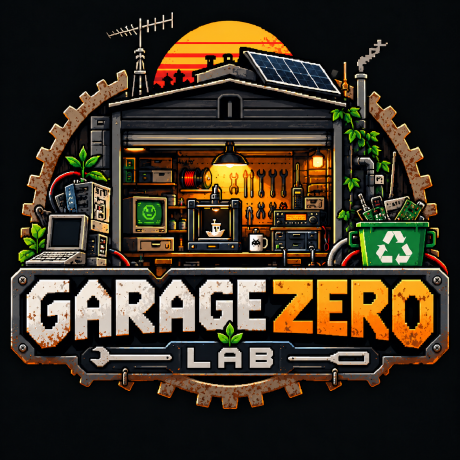

  

# Garage Zero Lab

Garage Zero Lab è un laboratorio maker indipendente dedicato all'elettronica, al recupero e al riuso. Si parte spesso da una scheda accantonata, un vecchio computer o un apparecchio guasto: si cerca di capire come funziona, cosa si può riparare e cosa può diventare utile in un altro progetto.

Qui trovano spazio curiosità, lavoro al banco e programmazione. L'obiettivo è imparare facendo e condividere ciò che si riesce davvero a costruire, misurare o rimettere in funzione.

## Sul banco

- **Recupero elettronico e riparazioni:** diagnosi dei guasti, riuso di componenti e ricerca di una seconda vita per l'hardware.
- **Retrocomputing:** vecchi computer, periferiche e interfacce da capire, conservare e riportare all'uso.
- **Embedded, Python e C:** microcontrollori, firmware, piccoli strumenti software e collegamenti tra codice e mondo fisico.
- **Radio e PCB:** circuiti, segnali, prove di ricezione e trasmissione, progettazione e prototipazione di schede.
- **Stampa 3D ed esperimenti hardware:** contenitori, supporti, adattatori e pezzi utili per completare o riparare qualcosa.

## Come lavoriamo

Prima di comprare, guardiamo quello che c'è già. Recuperiamo, adattiamo e scegliamo gli strumenti in base al problema: non si sprecano soldi in acquisti senza uno scopo. Quando serve un componente nuovo, la spesa deve avere una ragione concreta. L'ingegno, il tempo dedicato a capire e un buon metodo contano più del costo dell'attrezzatura.

La documentazione fa parte del lavoro: appunti, schemi, codice, modifiche e condizioni delle prove. Documentiamo anche i tentativi falliti, i limiti e le cose rimaste da risolvere, insieme ai risultati reali. Un esperimento riuscito a metà può comunque insegnare qualcosa, se si racconta con chiarezza cosa è successo.

Questo profilo è il punto di partenza per raccogliere il lavoro del laboratorio. I materiali verranno condivisi man mano che saranno disponibili, distinguendo le prove in corso dai risultati verificati.

## Dove trovarci

[Instagram](https://www.instagram.com/garagezerolab/) · [YouTube](https://www.youtube.com/@garagezerolab)
